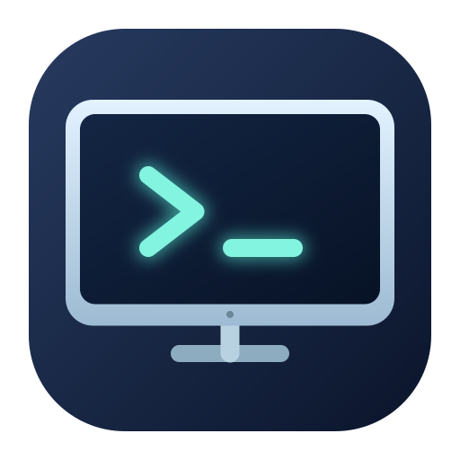

# Codex Display Switch



A small macOS menu bar app that powers off external monitors through DDC/CI while keeping them logically connected and the Mac awake. Computer Use can continue with the displays dark. Press any key on a connected keyboard to wake them, or use **Control-Option-Command-D** to toggle them.

The app is an independent utility and is not affiliated with OpenAI.

## Requirements

- Apple Silicon Mac with macOS 14 or later.
- External monitors that support DDC/CI power control (VCP `0xD6`), with DDC/CI enabled in the monitor settings.
- Xcode with Swift 6.2 or later to build from source.

macOS lock settings still apply. If the session locks while the monitors are dark, Computer Use may be interrupted. The app does not change your security settings.

## Build and use

```sh
Scripts/package_app.sh
open "build/Codex Display Switch.app"
```

The packaged app can be copied to `~/Applications`. To start it at login, add it in **System Settings → General → Login Items & Extensions**. Use the menu bar icon or the shortcut to turn the monitors off. A keyboard key wakes them again; that key may also reach the frontmost app, so Shift is a convenient wake key.

The bundled command line tool can check power state or wake the monitors if the menu bar app is unavailable:

```sh
"build/Codex Display Switch.app/Contents/MacOS/codex-displays" status
"build/Codex Display Switch.app/Contents/MacOS/codex-displays" on --direct
```

The app only sends an off command to monitors it can first read as on. Monitor firmware and DDC adapters vary, so verify compatibility before relying on it unattended. The build script uses an ad hoc signature; it does not produce a notarized release.

## License

MIT; see [LICENSE](LICENSE). [AppleSiliconDDC](https://github.com/waydabber/AppleSiliconDDC) and [swift-argument-parser](https://github.com/apple/swift-argument-parser) retain their own licenses in [ThirdPartyLicenses](ThirdPartyLicenses).
